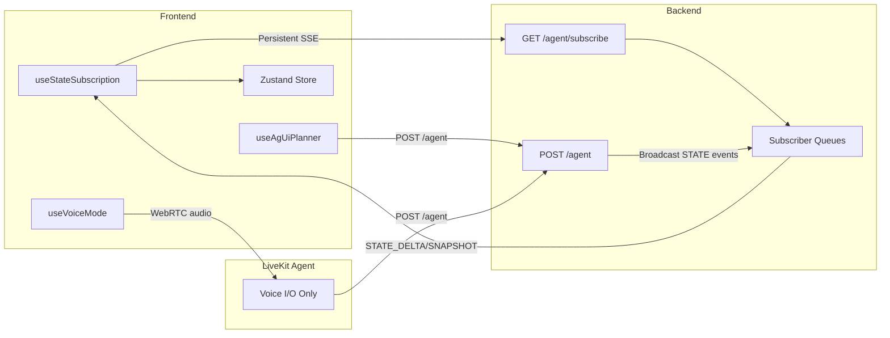

# Frontend Subscription Model Refactor

Replace the current "LiveKit agent as relay" pattern with a direct backend-to-frontend subscription model for state events.

## Changes Required

### 1. Backend: Add Subscription Infrastructure

Modify [project-planning-agent/server.py](project-planning-agent/server.py):

- Add `_subscribers: Dict[str, List[asyncio.Queue]]` for pub/sub
- Add `GET /agent/subscribe/{thread_id}` endpoint (persistent SSE)
- Add `broadcast_to_subscribers()` helper function
- Modify `stream_agent_events()` to broadcast STATE_DELTA and STATE_SNAPSHOT events

### 2. Frontend: State Subscription Hook

Create [frontend/src/hooks/useStateSubscription.ts](frontend/src/hooks/useStateSubscription.ts):

- Open persistent EventSource to `/agent/subscribe/{thread_id}`
- Parse incoming STATE_DELTA and STATE_SNAPSHOT events
- Call `store.applyDelta()` or `store.setFullState()` accordingly
- Handle reconnection on disconnect

### 3. Frontend: Integrate Subscription

Modify [frontend/src/App.tsx](frontend/src/App.tsx):

- Import and call `useStateSubscription(threadId)` at app level
- Ensure subscription is active regardless of chat/voice mode

### 4. LiveKit Agent: Simplify

Modify [livekit-adaptor/agent.py](livekit-adaptor/agent.py):

- Remove `_apply_delta()` method
- Remove `_update_room_metadata()` method
- Remove `_fetch_current_state()` method (optional, may keep for context)
- Simplify `query_planner()` to only extract TEXT_MESSAGE_CONTENT
- Remove room/state management from `PlannerAgent.__init__`

### 5. Frontend: Remove Room Metadata Handler

Modify [frontend/src/hooks/useVoiceMode.ts](frontend/src/hooks/useVoiceMode.ts):

- Remove `RoomEvent.RoomMetadataChanged` subscription (no longer needed)

### 6. Cleanup Dependencies

Modify [livekit-adaptor/requirements.txt](livekit-adaptor/requirements.txt):

- Remove `jsonpatch` (no longer needed in Python)

## Result

- Frontend receives ALL state events directly from backend
- LiveKit agent is pure voice I/O (~100 lines simpler)
- Full AG-UI consistency: same event handling for chat and voice
- No duplicated delta logic between Python and TypeScript