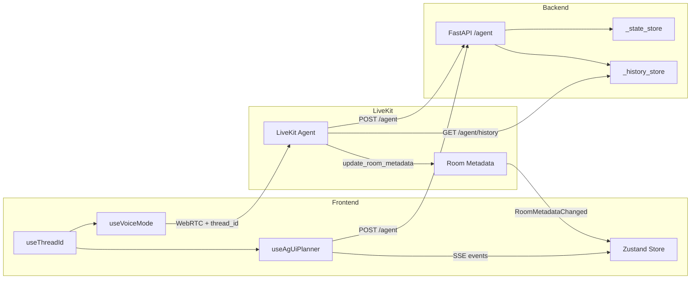

# Voice-Chat Bidirectional State Synchronization

Implement the architecture from [voice-chat-state-sync-spec.md](voice-chat-state-sync-spec.md) to enable:

- Shared `thread_id` across voice and chat
- Backend-managed conversation history persistence
- State updates pushed via LiveKit room metadata

## Implementation

### 1. Frontend: Thread ID Hook

Create [frontend/src/hooks/useThreadId.ts](frontend/src/hooks/useThreadId.ts) - stores stable `thread_id` in localStorage, shared by both channels.

### 2. Frontend: Update useAgUiPlanner

Modify [frontend/src/hooks/useAgUiPlanner.ts](frontend/src/hooks/useAgUiPlanner.ts):

- Import and use `useThreadId()` instead of `crypto.randomUUID()`

### 3. Frontend: Update useVoiceMode

Modify [frontend/src/hooks/useVoiceMode.ts](frontend/src/hooks/useVoiceMode.ts):

- Pass `thread_id` to token server
- Subscribe to `RoomEvent.RoomMetadataChanged`
- Update Zustand store when metadata changes

### 4. Backend: History Storage

Modify [project-planning-agent/server.py](project-planning-agent/server.py):

- Add `_history_store: Dict[str, List[Dict]]`
- Add `GET /agent/history/{thread_id}` endpoint
- Update `stream_agent_events` to save messages to `_history_store`

### 5. Token Server: Accept thread_id

Modify [livekit-adaptor/token_server.py](livekit-adaptor/token_server.py):

- Accept `thread_id` query parameter
- Store in token metadata as JSON

### 6. LiveKit Agent: Major Refactor

Modify [livekit-adaptor/agent.py](livekit-adaptor/agent.py):

- Update `PlannerAgent` to store `_room`, `_thread_id`, `_conversation_history`
- Fetch history from backend in entrypoint before session starts
- Rewrite `query_planner` to:
  - Fetch current state via `GET /agent/state/{thread_id}`
  - Send stored history + query to `POST /agent`
  - Parse `STATE_DELTA` / `STATE_SNAPSHOT` from response
  - Update room metadata via `api.LiveKitAPI().room.update_room_metadata()`
- Add `jsonpatch` to requirements for delta application

### Dependencies

- Add `jsonpatch` to [livekit-adaptor/requirements.txt](livekit-adaptor/requirements.txt)