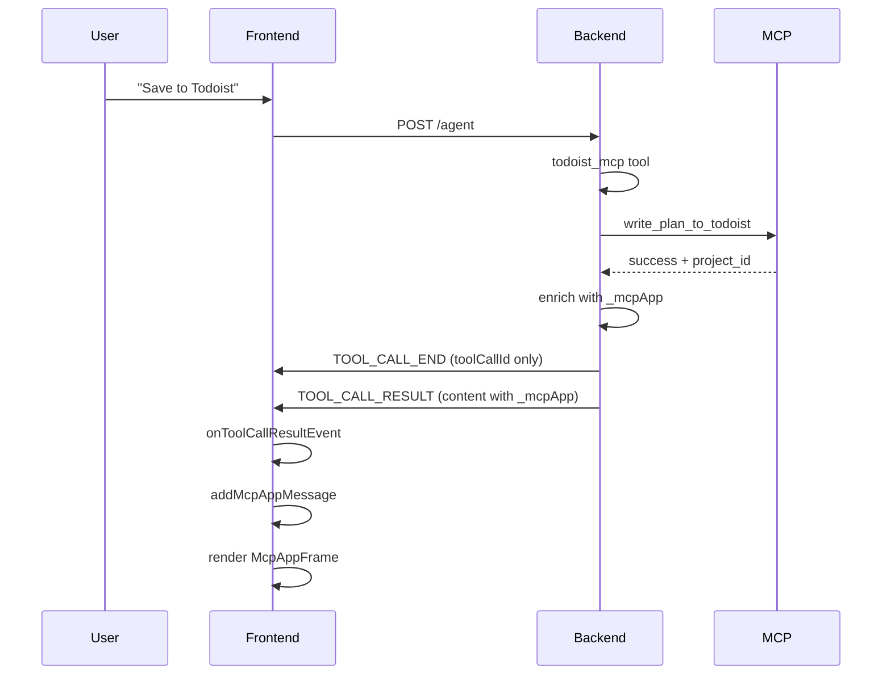

# MCP App UI Rendering Fix — Execution Plan

**Created**: 2026-02-08  
**Status**: Implemented

## Problem

MCP tools (e.g., Todoist export) run successfully and update Todoist, but the embedded editor (`ui://todoist-planner/editor.html`) never renders in chat. Root cause: the backend puts the tool result in `TOOL_CALL_END` via `tool_call_result`, but the AG-UI protocol reserves that event for `toolCallId` only. The frontend Zod schema strips unknown fields, so `event.toolCallResult` is never available and `addMcpAppMessage` is never called.

## Solution

Use the correct AG-UI event: emit `TOOL_CALL_RESULT` with the enriched JSON in `content` instead of stuffing it into `TOOL_CALL_END`. Update the frontend to listen to `onToolCallResultEvent` and parse `event.content` for `_mcpApp`.

---

## Implementation Plan

### Phase 1: Backend Changes

**File:** `project-planning-agent/server.py`

1. Import `ToolCallResultEvent` from `ag_ui.core` (alongside existing imports).
2. Refactor ToolMessage handling: For tools whose result is enriched with `_mcpApp` (currently only `todoist_mcp`):
   - Emit `TOOL_CALL_END` with only `tool_call_id` (remove `tool_call_result`).
   - Immediately after, emit `TOOL_CALL_RESULT` with: `message_id`, `tool_call_id`, `content` (enriched JSON), `role: "tool"`.
3. For other tools, keep emitting `TOOL_CALL_END` with `tool_call_result` for backwards compatibility.

### Phase 2: Frontend Changes

**File:** `frontend/src/hooks/useAgUiPlanner.ts`

1. Add `onToolCallResultEvent` handler: parse `event.content` as JSON, check for `result._mcpApp`, call `store.addMcpAppMessage()` when present.
2. Simplify `onToolCallEndEvent`: remove `_mcpApp` detection, keep only `store.endToolCall(event.toolCallId)`.

### Phase 3: Spec / Contract Updates

**File:** `specs/002-todoist-mcp-integration/contracts/ag-ui-events.md`

1. Update event sequence diagram: document `TOOL_CALL_END` (toolCallId only) + `TOOL_CALL_RESULT` (content with `_mcpApp`).
2. Update "How It Works" and "Detection in onToolCallResult" sections.

---

## Event Flow After Fix

---

## Verification

1. Start backend (`uvicorn server:app --reload --port 8000`), frontend (`npm run dev`), and Todoist MCP server (port 3001).
2. Add tasks to the plan, then say "Save this plan to Todoist."
3. Confirm the Todoist editor appears inline in the chat after the export completes.
4. Confirm no regressions: regular tool calls (move task, add task, etc.) still work.

---

## Rollback

Revert the three modified files. The change is isolated to event emission and handling; no schema or store changes.
